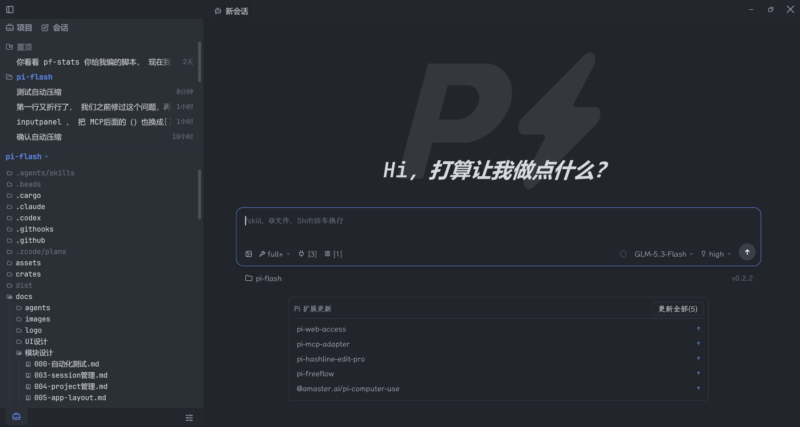

Pi Flash ： Windows上的极速 Pi coding agent！

需要 Node.js ≥ 22.19
> 平台范围：**仅 Windows x64**


## 演示


## 功能特性
- **模型管理**：设置面板内完成 provider 登录与 API key 管理（OS 凭据库加密保存）、模型白名单与通路测试。
- **技能 / 扩展 / MCP**：技能管理、扩展装载与内置扩展市场、MCP 服务器配置，一应俱全。
- **会话管理**：会话按项目分组管理，可恢复、重命名、置顶、删除，逾期自动清理、上下文用量与费用、自动/手动压缩上下文；支持跨项目的全量会话搜索。
- **消息级分支**：在任意一条回复上点「新分支」，即从该处复制出一份独立的会话文件继续对话，原会话保持不动。
- **项目文件工具**：文件树浏览与编辑、文件名 + 全文搜索、一键在内置终端运行脚本（exe/bat/ps1/js/py/sh）、Git 状态暂存与 diff 查看。
- **内置终端**：多标签页终端（alacritty + ConPTY），与文件树、会话同窗协作。
- **文件编辑与预览**：源码编辑，Markdown Preview，支持图片等常见格式预览。


## 快速开始

Pi Flash 仅支持 **Windows x64**。

方式一：npm 安装（需要 Node.js ≥ 22.19，用 `node --version` 检查版本）：

```bash
npm install -g pi-flash@latest   # 首次安装与更新同命令
pi-flash
```

方式二：绿色包，无需 Node——从 [GitHub Releases](https://github.com/danielbill/pi-flash/releases) 下载 `pi-flash-<版本>-win32-x64.zip`，解压后双击 `pi-flash.exe` 即用。

## 首次启动
如果还未配置过模型 provider，请打开「设置 → 模型」面板，点击「添加 Provider」添加 API key或登录。


## 许可证
本项目以 **GPL-3.0-or-later** 许可证发布（见 [LICENSE](LICENSE)），继承自Zed项目。
你可以自由使用、修改、分发本软件，但任何基于本软件的衍生作品**必须**以GPL-3.0-or-later 开源。
不接受未经 Copyright Holder 同意的闭源分发。

第三方组件的版权与许可证声明见[THIRD-PARTY-NOTICES.md](THIRD-PARTY-NOTICES.md)。


## 商标与名称
「Pi-Flash」名称、logo 与官方更新源是本项目所有者的标识。
你可以依据GPL-3.0-or-later 自由使用、修改和再分发本软件，但再分发时：

- **不得以 "Pi-Flash" 名义进行**：fork 须更名为可区分的名称，并在显著位置标注「基于 Pi-Flash 的非官方 fork」；
- **不得保留或指向官方更新通道**（自动更新源/插件市场），避免劫持官方用户的更新流；
- **不得使用官方 logo** 或做让用户混淆官方与 fork 的视觉标识。

本声明不限制 GPL-3.0-or-later 授予的代码自由，仅约束名称与标识的使用。
