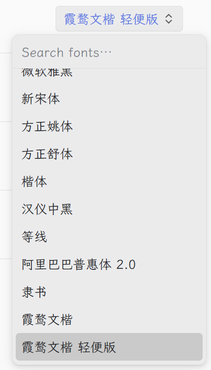

# 界面
title: 界面 Apperance

设置内容：
1、主题
2、字体
3、会话内容宽度（消息列 + inputpanel 同源）
4、语言

## 主题
淡色5个主题放一排
黑色2个主题放一排

主题配置写入 pi-flash 的 app_settings.json（不写 pi 的配置）。

## 字体
字体 Family 选择换成下拉菜单，宽度250px，高度400px，第一行是input框用来快速筛选字体

字体大小改变时，要直接反应在界面上

## 会话内容宽度
滑块 180px（规范 §5.12）+ 右侧实时读数 `920 px` + 「复位」钮；拖动即预览，
松手落盘到 `app_settings.json` 的 `chat_content_width`。阈值：默认 920 /
最小 560 / **最大 1200** / **步进 20**。列宽是 `w_full().max_w(cap)` 的封顶值，小屏
自动取可用宽，与机器分辨率无关。窗口：还原尺寸
1180×760（`WINDOW_W/H`），最小尺寸 1180×600（`WINDOW_W_MIN/H_MIN`，宽度
同还原宽、高度留出老屏幕的任务栏空间）。
消息列、composer 胶囊、新会话页内容带、ask 问卷卡读同一值（pi-web
`--chat-content-max-width` parity），改一处整列同宽。

## 语言
三个一行左对齐，宽度100px

=== 备注 ===
title：界面
不显示版本号

提示音选项在【其他】设置页

